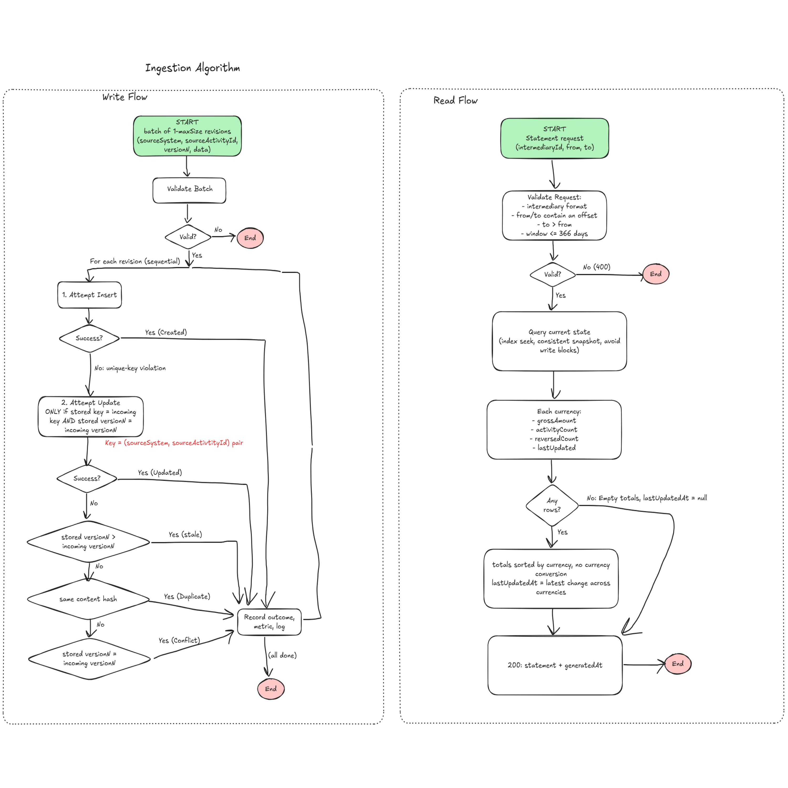

# IHub Intermediary Activity Statement: Solution Design

## Summary for reviewers

**What it is.** A .NET 10 service with SQL Server. Producers `POST` batches of activity revisions; brokers `GET` a statement of gross totals per currency for a time window. It runs locally with `docker compose up --build`.

**How totals stay correct.** The database enforces three rules, so no in-process locks or coordination are needed and the rules hold however many instances run:

1. **One row per activity.** A unique index on `(sourceSystem, sourceActivityId)` makes a duplicate impossible to store.
2. **Highest version wins.** A single `UPDATE ... WHERE Version < @new` applies a revision only if it is newer, so arrival order does not matter.
3. **Nothing is pre-aggregated.** A statement is one indexed `SUM` over the current rows, so there is no running total for concurrent writers to corrupt.

**How I know it works.** The guarantees are measured, not just described ([section 7](#7-evidence-correctness-under-load-and-failure)):

| Evidence | Result |
| --- | --- |
| Property test: random activity histories (corrections, reversals, moves between brokers, version gaps, mixed offsets), duplicated, shuffled and sent concurrently, then compared with an independent reference model | 55 seeds, 0 divergences. A deliberately broken version guard fails the test |
| Load simulation: 17,756 deliveries (with duplicates, out of order) for 200 brokers against the Docker stack | 2,583 activities/s on a laptop (about 2,000-2,800 across runs); all 200 statements exact |
| Failure simulation: SQL Server container restarted mid-load at 400 activities/s | 3 of 855 requests returned 503 and were retried by producers; activities whose acknowledgement was lost resolved as `Duplicate`; all 200 statements exact |

**Brief requirement → where it is answered**

| Requirement | Section |
| --- | --- |
| API, data model, assumptions | [2](#2-assumptions), [3](#3-api), [4](#4-data-model) |
| No double counting, out-of-order arrival, concurrency | [5](#5-correctness-duplicates-out-of-order-arrival-concurrency), proven in [7](#7-evidence-correctness-under-load-and-failure) |
| Growth to more activity types and sources | [10](#10-growth-more-activity-types-and-sources) |
| Signals exposed and why; two alerts with thresholds and actions | [8](#8-observability) |
| AWS architecture, delivery, rollout, migrations, configuration, failures, capacity | [9](#9-aws-run-plan) and [docs/aws-run-plan.md](docs/aws-run-plan.md) |
| Trade-offs, assumptions, AI use | [11](#11-trade-offs), [2](#2-assumptions), [13](#13-use-of-ai-tools) |

---

## 1. Decisions at a glance

| Area | Decision | Reason |
| --- | --- | --- |
| Stack | .NET 10 (LTS) Minimal APIs, EF Core 10, SQL Server 2022 | Fits the existing .NET estate; little framework code for two endpoints |
| Ingestion | One HTTP endpoint: `POST /api/v1/activities`, batches of 1-500 | Producers batch naturally; the same code later sits behind an SQS consumer |
| Retrieval | One HTTP endpoint: `GET /api/v1/intermediaries/{id}/statement?from&to` | A statement is a read-only view |
| Identity and ordering | `(sourceSystem, sourceActivityId)`; source-assigned `version`, highest wins | Deterministic and independent of clocks or arrival order |
| Cancellations | A new version with `status = Reversed` | One row per activity; a reversal is just another revision |
| Statement | Computed on read with one grouped query on a covering index | Always consistent with the stored data; nothing to keep in sync |
| Processing | Synchronous: committed means visible in the next statement | Lowest possible delay, one fewer moving part |
| Money and time | `decimal(19,4)`, per-currency totals, no conversion; UTC, offsets required, window `[from, to)` | Exact arithmetic; no ambiguous timestamps; adjacent windows never overlap |
| Observability | JSON logs with correlation IDs, OpenTelemetry metrics at `/metrics`, liveness and readiness probes | Answers "is it working, how fast, what broke" with no extra tooling |

## 2. Assumptions

| # | Assumption | Effect on the design |
| --- | --- | --- |
| A1 | Each source gives every activity a stable ID. | Identity is `(sourceSystem, sourceActivityId)`. |
| A2 | A source can number an activity's revisions (row version, sequence, event number). | Out-of-order arrival is resolved by version, not time. |
| A3 | An activity is `Active` or `Reversed`; a cancellation is a new revision. | Only `Active` activities count; reversals are reported separately. |
| A4 | Amounts are non-negative; clawbacks are their own activity type. | The gross total is genuinely gross. |
| A5 | Brokers can earn in several currencies, and IHub must not convert. | Totals are per currency. |
| A6 | A statement window refers to when the activity happened (`occurredAt`). | A late arrival can change a past window; `lastUpdatedAt` shows when it did. |
| A7 | Identifiers are opaque and case-sensitive. | Binary collation on key columns: `POL-1` and `pol-1` are different activities. |
| A8 | Peak load is thousands of activities per hour, with bursts. | Synchronous processing in the request is enough; no queue inside the service. |
| A9 | Authentication is handled in front of the service (gateway or identity provider). | No auth code in the slice. |

## 3. API

Versioned in the path. Errors are RFC 9457 problem details. Every request accepts and returns `X-Correlation-ID`.

### 3.1 `POST /api/v1/activities`

```json
{ "activities": [ {
    "sourceSystem": "life-admin", "sourceActivityId": "POL-1001-COMM", "version": 2,
    "intermediaryId": "BRK-001", "activityType": "commission", "status": "Active",
    "amount": 1500.00, "currency": "ZAR", "occurredAt": "2026-10-05T09:15:00+02:00" } ] }
```

The response gives each item's outcome in request order, so producers can reconcile:

| Outcome | Meaning | Changes statement |
| --- | --- | --- |
| `Created` | First revision of this activity | Yes |
| `Updated` | Higher version than stored; replaces it | Yes |
| `Duplicate` | Same version and content as stored (retry or redelivery) | No |
| `Stale` | Lower version than stored (arrived out of order) | No |
| `Conflict` | Same version, different content: a producer bug. Not applied; logged and counted | No |

`200` means the batch was processed. `400` means validation failed and nothing was applied; errors name the field, e.g. `activities[3].amount`. `503` (with `Retry-After`) means the database is unavailable and the whole batch can be resent. `500` includes the `correlationId`.

A batch is validated as a unit: partial acceptance would force producers to track which items went through. Because processing is idempotent, the producer rule is simply "fix and resend the whole batch".

### 3.2 `GET /api/v1/intermediaries/{id}/statement?from=...&to=...`

```json
{ "intermediaryId": "BRK-001",
  "window": { "from": "2026-10-01T00:00:00+00:00", "to": "2026-11-01T00:00:00+00:00" },
  "totals": [ { "currency": "ZAR", "grossAmount": 2320.5000, "activityCount": 2, "reversedActivityCount": 0 } ],
  "lastUpdatedAt": "2026-11-02T13:20:01.512+00:00",
  "generatedAt": "2026-11-02T13:25:44.090+00:00" }
```

`grossAmount` sums `Active` activities whose `occurredAt` is in `[from, to)`. `lastUpdatedAt` is when any activity in the window last changed, including reversals (`null` if none). `generatedAt` is the point in time the statement reflects. Both bounds are required (statement periods are a business definition), and a window may span at most 366 days. An intermediary with no activity gets an empty `200`: without an intermediary registry, unknown and inactive cannot be told apart.

### 3.3 Operational endpoints

`/health/live` (process up, no dependency checks, so a database outage never restarts healthy containers), `/health/ready` (database reachable; the load balancer target) `/metrics` (Prometheus format) and `/scalar` (API reference, enabled by configuration).

## 4. Data model

One current-state table, one row per activity.

| Column | Type | Purpose |
| --- | --- | --- |
| `Id` | `bigint identity`, clustered PK | Burst inserts append instead of splitting pages |
| `SourceSystem`, `SourceActivityId` | `varchar(50)`, `varchar(100)`, BIN2 | Identity |
| `Version` | `bigint`, check `>= 1` | Orders revisions |
| `IntermediaryId` | `varchar(50)` BIN2 | Statement owner |
| `ActivityType` | `varchar(50)` | Free-form business type |
| `Status` | `varchar(16)`, check | `Active` or `Reversed` |
| `Amount`, `Currency` | `decimal(19,4)` check `>= 0`, `char(3)` | Exact money |
| `OccurredAt` | `datetimeoffset` (UTC) | Statement windowing |
| `ContentHash` | `binary(32)` | SHA-256 of business fields; tells `Duplicate` from `Conflict` |
| `FirstReceivedAt`, `UpdatedAt` | `datetimeoffset` | Receipt time; drives `lastUpdatedAt` |
| `LastCorrelationId` | `varchar(64)` | Links a row to the request (and logs) that last changed it |

| Index | Definition | Used for |
| --- | --- | --- |
| `UX_Activities_SourceKey` | Unique `(SourceSystem, SourceActivityId)` | The idempotency guarantee |
| `IX_Activities_Intermediary_OccurredAt` | `(IntermediaryId, OccurredAt)` INCLUDE `(Status, Currency, Amount, UpdatedAt)` | The statement query, answered from the index alone |

Choices made for real-world data:

- **Binary collation on identifiers.** SQL Server's default is case-insensitive and would silently merge `pol-1` and `POL-1`.
- **ASCII-only identifiers in `varchar`.** SQL Server replaces non-ASCII characters in `varchar`, which could make two IDs equal.
- **Check constraints** (`Version >= 1`, `Amount >= 0`, valid `Status`). They duplicate API validation on purpose, to protect against backfills and scripts.
- **Read Committed Snapshot Isolation**, enabled in the initial migration. Statement reads see a consistent snapshot and never block, or are blocked by, ingestion.

Schema changes are EF Core migrations. Locally they are applied at startup before Kestrel listens, so readiness cannot pass against an old schema. In production they run as a separate deployment step.

## 5. Correctness: duplicates, out-of-order arrival, concurrency

### 5.1 Write algorithm ([ActivityIngestor.cs](src/IHub.Api/Features/Activities/ActivityIngestor.cs))

```
1. INSERT the revision                                   -> Created
     unique-key violation: the activity exists, go to 2
2. UPDATE ... SET <fields>, Version = @v
   WHERE SourceSystem = @s AND SourceActivityId = @id AND Version < @v
     1 row                                               -> Updated
     0 rows: stored version is the same or newer, go to 3
3. SELECT Version, ContentHash (reporting only)
     stored version > @v                                 -> Stale
     same version, same hash                             -> Duplicate
     same version, different hash                        -> Conflict
```

Steps 1 and 2 decide what is stored; step 3 only explains the outcome to the producer.



*Hand-drawn sketch of the ingestion algorithm, designed and tested before this service was built ([SVG](docs/designs/ingestion-algorithm.svg)).*

### 5.2 Why it holds under concurrency

| Race | What SQL Server does | Result |
| --- | --- | --- |
| Two inserts of a new activity | The unique index admits one; the other gets error 2627/2601 and goes to step 2 | One row |
| Two updates (v2, v3) | The row's update lock serialises them; the second re-evaluates `Version < @v` against the committed row | v3 is stored, whichever arrives first |
| An older or repeated version racing a newer one | Its predicate is false against the newer row | `Stale` or `Duplicate` |
| A statement read during ingestion | RCSI serves a consistent committed snapshot without blocking | Totals as of one point in time |
| Several service instances | No in-memory locks or caches; all coordination is in the database | Scale out without changes |

Concurrent submissions for the **same intermediary** need nothing extra: different activities are different rows, and there is no per-intermediary total to contend on.

### 5.3 Retries and partial failure

Revisions in a batch commit one by one. If a batch fails midway, the producer resends all of it; revisions that already committed come back as `Duplicate`. EF Core's `EnableRetryOnFailure` retries transient database errors, which is safe for the same reason: a retried insert that had in fact committed hits the unique key. The unique-key violations behind normal duplicate handling are logged at `Debug`, so they never page anyone.

## 6. How the statement is derived

[StatementQuery.cs](src/IHub.Api/Features/Statements/StatementQuery.cs):

```sql
SELECT Currency,
       SUM(CASE WHEN Status = 'Active' THEN Amount ELSE 0 END),
       COUNT(CASE WHEN Status = 'Active' THEN 1 END),
       COUNT(CASE WHEN Status = 'Reversed' THEN 1 END),
       MAX(UpdatedAt)
FROM   Activities
WHERE  IntermediaryId = @id AND OccurredAt >= @from AND OccurredAt < @to
GROUP  BY Currency;
```

It is a seek on the covering index. Computing on read means there is no second copy of the data to keep atomic, compensate when a version changes the amount or broker, or rebuild after drift. Activities are visible as soon as they commit.

If reads become heavy (a portal polling every few seconds) or windows span years of busy data, the next step is a daily summary table `(IntermediaryId, Currency, Day)` updated in the same transaction as the activity write. The write path already has the old and new state of each activity, so the API would not change.

## 7. Evidence: correctness under load and failure

### 7.1 Unit tests

Unit tests cover validation rules, strict timestamp parsing, content hashing, and the SQL shape of the statement query: a single `SELECT`, aggregated in SQL and filtered on the index keys, so a refactor cannot quietly move the aggregation into memory.

### 7.2 Integration tests

Integration tests run the real API in-process against SQL Server in a container (Testcontainers), because unique-key and locking behaviour can only be tested on the real engine. Each test uses its own intermediary, so tests are independent while sharing one database.

| Test | Scenario |
| --- | --- |
| `Resubmitting_the_same_revision_is_counted_once` | The same revision sent three times: `Created`, `Duplicate`, `Duplicate`; counted once |
| `Duplicates_within_one_batch_are_counted_once` | The same revision twice in one batch |
| `Reversal_that_arrives_before_the_original_is_not_undone_by_it` | v2 `Reversed` arrives before v1 `Active`; v1 is `Stale` and the total is 0 |
| `Newer_version_replaces_the_stored_state` | v1 for 100, then v2 for 250; the total is 250 |
| `Same_version_with_different_content_is_flagged_as_conflict_and_not_applied` | A producer bug is reported and the stored revision kept |
| `Concurrent_submissions_for_one_intermediary_are_all_counted_exactly_once` | 40 activities, each sent twice, as 80 parallel requests; the sum is exact |
| `Concurrent_versions_of_one_activity_converge_on_the_highest_version` | 25 versions, each sent twice in random parallel order; one `Created`, v25 stored |
| `Activity_moved_to_another_intermediary_leaves_the_first_statement` | A newer version with a different broker moves the amount |
| `StatementTests` | Half-open window boundaries, time zone offsets, per-currency totals, `lastUpdatedAt` on reversal, empty windows, invalid windows |

### 7.3 Property test: convergence against a reference model

Example tests check the interleavings someone thought of. [ConvergencePropertyTests](tests/IHub.Api.Tests/Integration/ConvergencePropertyTests.cs) checks the rule itself:

- A seeded [generator](tools/IHub.Simulator/Workload/WorkloadGenerator.cs) creates activity histories with corrections, reversals, moves between brokers, version gaps (1, 2, 4), time corrections across window boundaries, and the same instant written in UTC or SAST.
- Each revision is redelivered with 40% probability, everything is shuffled, cut into random batches and sent with 12 concurrent producers.
- The result is compared with a [reference model](tools/IHub.Simulator/Workload/ReferenceModel.cs) about ten lines long ("keep the highest version, sum the active ones in the window"). Every stored row and every statement must match it, with exactly one `Created` per activity and no `Conflict`.

Five fixed seeds run on every build. `IHUB_PROPERTY_SEEDS=random:50 dotnet test` explores new ones; 50 random seeds passed. A failure prints the seed and the exact diverging rows, and `IHUB_PROPERTY_SEEDS=<seed>` replays it.

**Does the test catch real bugs?** I changed the version guard from `Version < @v` to `Version != @v`, a plausible slip that lets older versions overwrite newer ones. The test failed, listing activities such as `stored v1, expected v4`.

### 7.4 Load and failure simulation

[IHub.Simulator](tools/IHub.Simulator) drives the running Docker stack with the same generator, behaves like at-least-once producers (exponential backoff with jitter, honouring `Retry-After`), can restart the database container mid-run, and finally reconciles every broker's statement against the reference model. Measured on a laptop (Core i9-11950H; API and SQL Server sharing one Docker VM):

| Scenario | Workload | Result |
| --- | --- | --- |
| [Baseline](docs/simulation/baseline.md) | 5,000 activities, 12,521 revisions, 17,756 deliveries, 200 brokers, 16 producers, unthrottled | **2,583 activities/s** (about 2,000-2,800 across runs); p95 request (25 per batch) 223 ms; all 200 statements exact |
| [Database restart](docs/simulation/database-restart.md) | 6,000 activities, 21,283 deliveries at 400/s; SQL Server restarted at 15 s | Ingestion paused about 3 s (3-14 s across runs), then the backlog cleared. Only **3 of 855 requests returned 503**: EF Core's retries absorbed the rest, at the cost of a p99 of 4.4 s. Readiness went unready, then ready, as a load balancer would see. All 200 statements exact |

The restart run shows the lost-acknowledgement case. Of 6,000 activities, 5,991 were `Created`; the other 9 were reported `Duplicate`. Their inserts committed just as the database stopped, the acknowledgement was lost, and the retries were correctly recognised as repeats. Nothing was double counted.

```
Acknowledged per second (database restarted at 15 s):
▂▂▂▂▂▂▂▂▂▂▂▂▂▂▂▂▁···▂█▂▂▂▂▂▂▂▂▂▂▂▂▂▂▂▂▂▂▂▂▂▂▂▂▂▂▂▂▂▂▂▁
```

At the brief's peak of thousands of activities per hour (1-3 per second), that is roughly a thousandfold headroom on a single instance.

## 8. Observability

### 8.1 Signals

| Signal | Answers |
| --- | --- |
| `/health/ready`, `/health/live` | Can this instance take traffic? Is the process alive? |
| `http.server.request.duration` (route, status), built in | Throughput, latency percentiles, error rate per endpoint |
| `ihub.activities.processed` (outcome, source) | Volume, and the mix of duplicates, stale and conflicts per producer |
| `ihub.activity.ingest_lag` (source), histogram | **Processing delay**: from `occurredAt` to commit, which is when the activity appears in statements |
| `ihub.ingest.batches.rejected` (reason) | Is a producer sending invalid data? |
| `ihub.errors` (error type) | Which server-side failures, e.g. `database_unavailable` |
| Runtime metrics | GC, thread pool, exceptions |
| JSON logs with `CorrelationId` | What happened to this request? |

Ingest lag is tagged by source, which separates "an upstream system is late" from "IHub is behind". The `source_system` tag is limited to a configured list (anything else is `other`), so a misbehaving producer cannot create unbounded metric series.

### 8.2 Logs and end-to-end correlation

A caller's `X-Correlation-ID` is adopted if log-safe, otherwise generated. It is echoed in the response, added to every log line's scope (with W3C trace and span IDs) and included in error bodies. Each activity row stores `LastCorrelationId`, so the trail also runs from data to logs: for a suspicious statement line, find the request that last changed it. Log events have stable IDs (4001 activity outcome, 4002 conflict, 3001 server error, and so on). Probe and scrape requests log at `Debug`. Integration tests cover the health probes, the metrics output and correlation ID propagation.

```json
{"Timestamp":"2026-11-02T13:20:01.512Z","EventId":4001,"LogLevel":"Information","Message":"Activity Updated: life-admin/POL-1001-COMM v3 for intermediary BRK-DEMO-001","State":{"Outcome":"Updated","SourceSystem":"life-admin","Version":3},"Scopes":[{"TraceId":"4bf92f35..."},{"CorrelationId":"demo-step-4"}]}
```

### 8.3 Alerts (CloudWatch, from scraped metrics plus ALB and SQS metrics)

| Alert | Condition | Operator action |
| --- | --- | --- |
| **Rising error rate** (page) | 5xx above 2% of requests for 5 min, or `ihub.errors{error_type="database_unavailable"}` above 0 for 3 min, or fewer than 2 healthy targets | Check `/health/ready` and RDS events (failover, CPU, storage). If it started with a deployment, roll back. Use a failing response's `correlationId` to find the exception |
| **Growing processing delay** (page) | p95 `ihub.activity.ingest_lag` above 15 min for 15 min, or SQS oldest message older than 10 min | One `source_system` late: upstream issue, contact its owners. All late with a growing queue: IHub is behind, so check scaling and RDS load. Check the DLQ for poison messages |
| Producer conflicts (ticket) | Any `outcome="conflict"` within an hour | A source reused a version with different content; raise it with the owning team |

## 9. AWS run plan

Design only. The full plan, covering upstream delivery, migrations, configuration and secrets, failure modes and capacity, is in **[docs/aws-run-plan.md](docs/aws-run-plan.md)**.

- **Architecture.** Product systems publish to SNS; IHub consumes from its own SQS queue (with a DLQ) using an ECS Fargate worker that calls the same ingestion code as the HTTP endpoint. The statement API runs as a second Fargate service behind an ALB, with API Gateway or an identity provider in front for broker traffic. Data lives in RDS SQL Server Multi-AZ.
- **Deployment.** ECS blue/green through CodeDeploy, with a 10% canary gated on readiness and the error-rate alarm, and automatic rollback. Chosen because rollback is a traffic switch to a version that is still running. Migrations run beforehand as a one-off task, using expand/contract changes.
- **Capacity.** The brief's peak is about 1-3 activities per second; one instance measured about 2,000 per second (§7.4), so the database is the scaling limit. Start with 2 worker and 2 API tasks across AZs and `db.m6i.large`; scale the worker on queue backlog and the API on CPU.

## 10. Growth: more activity types and sources

| Change | What it takes |
| --- | --- |
| New source system | Nothing: identity already includes it. Add it to `Ingestion:KnownSourceSystems` for its own metric series |
| New activity type | Nothing: `activityType` is a free-form code |
| Totals by type | Add `ActivityType` to the index INCLUDE list and the `GROUP BY`; additive for clients |
| Debit types (clawbacks) | An activity-type catalogue with a direction; return `netAmount` beside `grossAmount` |
| A source without versions | An adapter derives a monotonic version (sequence, commit timestamp) and calls the same ingestor |
| New transport (SQS, Kafka, files) | A thin consumer calls the existing validator and `ActivityIngestor`; at-least-once delivery is fine |
| Audit and "statement as at" | An append-only `ActivityRevisions` table written in the same transaction |

Code is organised by feature (`Features/Activities`, `Features/Statements`), so a capability usually touches one folder. SQL Server-specific code is confined to [SqlServerErrors.cs](src/IHub.Api/Persistence/SqlServerErrors.cs).

## 11. Trade-offs

| Chose | Over | Because |
| --- | --- | --- |
| Insert, then version-guarded update | `MERGE` | `MERGE` needs `HOLDLOCK` to be concurrency-safe and has a history of edge-case bugs; two plain statements are easier to reason about |
| Insert first | Update first | Most traffic is new activities; duplicates pay for a caught exception, which is affordable at this volume |
| Current-state table | Deriving statements from an event log | The "latest version" work happens once, on write; an audit log can sit alongside (section 12) |
| Totals on read | Stored running totals | Exact by construction; section 6 has the upgrade path |
| Source version numbers | Last write wins on timestamps | Clocks drift and tie; versions give the same answer every time |
| Whole-batch validation | Accepting the valid items | Idempotency makes resending the whole batch free; partial acceptance pushes tracking onto producers |
| Synchronous processing | An in-process queue | More latency and failure modes without improving correctness; in AWS, SQS is the asynchronous step |
| EF Core | Dapper | The critical write is still one explicit SQL statement; EF adds migrations, pooling and health checks |
| One project, organised by feature | Clean-architecture projects | Two endpoints do not need the indirection; folders split cleanly later |
| SQL Server | PostgreSQL | Either works; SQL Server matches the estate. The costs are a heavier local image and RDS licensing |

Build hygiene: central package management, NuGet audit including transitive packages (a vulnerable `System.Security.Cryptography.Pkcs` is pinned to a patched version), warnings as errors, pinned SDK and SQL Server image tags, and CI that builds, runs all tests including Testcontainers, checks migrations match the model, and runs the failure simulation against the Compose stack.

## 12. Known limitations and next steps

1. **Authentication and authorisation.** IAM for SQS, OAuth client credentials for HTTP. A broker reads only their own statement, with the ID taken from the token rather than the URL.
2. **Append-only `ActivityRevisions` table** written in the same transaction, for audit, "statement as at a date" (useful in commission disputes) and rebuilds.
3. **The SQS consumer worker**, reusing the existing ingestion code.
4. **OTLP trace export** to X-Ray or ADOT; trace context is already propagated into logs.
5. **Itemisation and a per-type breakdown**, served by the existing index with a wider INCLUDE list.
6. **A set-based batch write** (table-valued parameter) if a source ever needs bulk backfills well beyond the measured ~2,000/s.
7. **Run the simulator against a production-sized RDS instance** before go-live to confirm the capacity figures.

## 13. Use of AI tools

The ingestion algorithm is my own: insert, then a version-guarded update, then classifying the outcome. I designed it and tested it outside this solution before building the service around it.

The design diagrams in [`docs/designs/`](docs/designs/) were drawn by me, without AI tools, before implementation began: [ingestion algorithm](docs/designs/ingestion-algorithm.png) ([SVG](docs/designs/ingestion-algorithm.svg)).

I used Claude Code (Anthropic) as a pair programmer: I proposed and decided, it drafted, offered alternatives and challenged my choices. Example prompts:

- **Implementation.** Claude Code drafted code, tests, the property test, the load and failure simulator and the documentation from the agreed design. I reviewed each step and steered how the work was structured.
  - *"SOLUTION.md must evolve with every commit we make."*
  - *"Follow [these commit guidelines](https://chris.beams.io/git-commit)."*
- **Review.** Checking the work against the brief and deciding which scenarios the tests must prove.
  - *"Run tests following these scenarios:"*
    - The same revision resubmitted, including within one batch, is counted once
    - A newer version replaces the stored state; an older one arriving late is ignored
    - A reversal that arrives before the original is not undone by it
    - The same version with different content is flagged as a conflict and not applied
    - Concurrent submissions for one intermediary are all counted exactly once
    - Concurrent versions of one activity converge on the highest version
    - An activity moved to another intermediary leaves the first statement
    - An invalid batch is rejected as a whole and applies nothing
    - Statement windows are half-open and respect time zone offsets
    - Currencies are totalled separately and never converted
    - Any delivery order, with duplicates and concurrency, matches an independent reference model (property test)
    - Load at about 2,500 activities/s, and a database restart mid-load, leave every statement exact (simulator)

I made, and own, every design decision. The correctness claims rest on the tests and measurements in section 7, run on my machine, not on anything the tool asserted.
