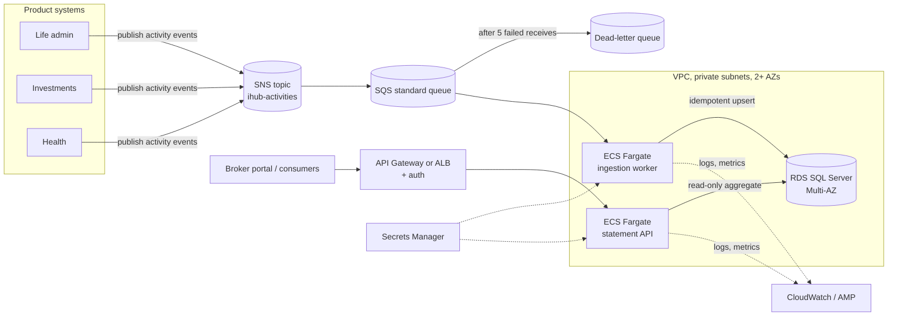

# IHub Activity Statement: AWS Run Plan

Design only. How the service in this repository would run on AWS under real load. The summary is in [SOLUTION.md §9](../SOLUTION.md#9-aws-run-plan).

## Architecture

| Component | Choice | Reason |
| --- | --- | --- |
| Compute | ECS on Fargate: one image, two services (ingestion worker and statement API), each across two or more AZs | Long-running tasks keep pooled connections to SQL Server; no hosts to patch; each service scales on its own signal |
| Database | RDS for SQL Server, Multi-AZ, gp3 storage, automated backups with point-in-time restore | Managed failover and backups; the same engine as local development and tests |
| Messaging | SNS fan-out to an SQS standard queue with a dead-letter queue | Producers do not depend on IHub being up, and the queue absorbs daytime peaks |
| Edge | Internal ALB for the API; API Gateway or an identity provider in front of broker traffic | TLS, health-checked routing, and authentication kept outside the service |
| Configuration | Environment variables from the task definition; non-secret settings in SSM Parameter Store | The same image runs in every environment |
| Secrets | Secrets Manager with rotated database credentials, injected as task secrets | No secrets in images, repositories or environment files |
| Observability | CloudWatch Logs (JSON, queryable with Logs Insights); `/metrics` scraped inside the VPC by Amazon Managed Prometheus or the CloudWatch agent; alarms to SNS or PagerDuty | Covers the signals and alerts in SOLUTION.md §8. `/metrics` is never exposed through the ALB |

## How upstream activity is delivered and consumed

Product systems publish activity revisions to an SNS topic. Each consumer, IHub included, subscribes with its own SQS queue, so adding consumers never touches producers.

The worker long-polls the queue and passes each message to the same validator and `ActivityIngestor` the HTTP endpoint uses. It deletes a message only after the revision has committed. A crash before that means redelivery, which resolves as `Duplicate`.

A standard queue is enough, and FIFO is not needed. The write path already tolerates duplicates and any delivery order, so FIFO's ordering and deduplication would add cost and a throughput ceiling without making anything more correct. Messages that fail validation go straight to the DLQ with the errors attached. Other failures retry through the visibility timeout and are dead-lettered after 5 receives.

The HTTP endpoint stays available for systems that cannot publish to SNS.

## Deployment approach

**ECS blue/green through CodeDeploy**, triggered from GitHub Actions using OIDC federation (no long-lived AWS keys):

1. CI builds, runs all tests including the Testcontainers suite, and pushes an image tagged with the commit SHA to ECR, where it is scanned.
2. The pipeline runs database migrations as a one-off ECS task (below).
3. CodeDeploy starts the green task set, waits for `/health/ready`, shifts 10% of traffic for 5 minutes, then the rest.
4. If the error-rate alarm fires or health checks fail during the bake period, CodeDeploy rolls back automatically. The blue task set keeps running until the bake period ends.

**Why blue/green:** rollback is a traffic switch to a version that is still running, and the canary limits how many brokers see a bad release. A rolling update mixes versions and has no single switch to undo. The queue worker serves no traffic, so it uses an ECS rolling update with the deployment circuit breaker.

## Database migrations

- Migrations are built as an EF Core migration bundle and run as a one-off ECS task before the new application version starts. That task uses a login with DDL rights; the application's login has DML rights only, and `Database:ApplyMigrationsOnStartup` is `false`.
- Every change follows expand/contract: add columns or tables in one release, use them in the next, drop old ones only when no running version needs them. Old and new versions can then run side by side during blue/green.
- For large-table changes, `dotnet ef migrations script --idempotent` produces a script for DBA review. EF Core takes a lock while migrating, so two runs cannot overlap.

## Failure modes

| Failure | Behaviour and mitigation |
| --- | --- |
| RDS Multi-AZ failover (1-2 min) | EF Core retries transient errors. The API returns 503 with `Retry-After`, and SQS messages stay queued for redelivery. A database restart under load was measured locally: 3 of 855 requests returned 503 and every total stayed exact (SOLUTION.md §7.4) |
| Bad deployment | The canary and error-rate alarm trigger an automatic CodeDeploy rollback |
| Poison message | Validation failures go to the DLQ immediately, and others after 5 receives. A DLQ depth alarm notifies the team, and messages are redriven after a fix |
| Upstream replays a day of events | Replays resolve as `Duplicate` or `Stale`, so statements do not change. The queue grows and the worker scales out to drain it |
| Upstream reuses a version number | Recorded as `Conflict`, not applied, and the conflict ticket alert fires |
| Availability Zone outage | At least two tasks per service spread across AZs; RDS fails over to its standby |
| Task crashes mid-batch | Uncommitted revisions are redelivered by SQS or resent over HTTP; committed ones return as `Duplicate` |

## Capacity and scaling

- **Load.** The brief's peak of thousands of activities per hour is about 1-3 per second. One instance on a laptop sustained about 2,000-2,800 per second (SOLUTION.md §7.4), so the database becomes the limit long before compute does.
- **Baseline.** 2 worker tasks and 2 API tasks (0.5 vCPU, 1 GB each), one per AZ; RDS `db.m6i.large` (2 vCPU, 8 GB) Multi-AZ.
- **Scaling.** The worker scales on SQS backlog per task, targeting under a minute of backlog. The API scales on CPU (60%) and requests per target. Maximum tasks × connection pool size must stay within the RDS connection limit.
- **Storage.** At most about 10,000 activities an hour for 12 hours a day is about 44 million rows a year, roughly 20 GB with indexes. Statement cost does not grow with the table, because each query seeks one broker's rows. After a few years, partition by month on `OccurredAt` and archive closed periods.
- **Read peaks.** If broker portals poll heavily, cache closed-period statements briefly at the edge. If that is not enough, add the daily summary table described in SOLUTION.md §6.

## Assumptions and trade-offs

- Producers can publish to SNS, and those that cannot keep using HTTP.
- Brokers authenticate through a gateway or identity provider. The service trusts the intermediary ID from the token, not the URL.
- SQL Server on RDS carries a licence cost that Aurora PostgreSQL would avoid. The provider-specific code is one file (`SqlServerErrors.cs`), so a move stays small.
- Fargate costs more per vCPU than EC2-backed ECS, in exchange for no hosts to patch or scale. At this load, the difference is small.
